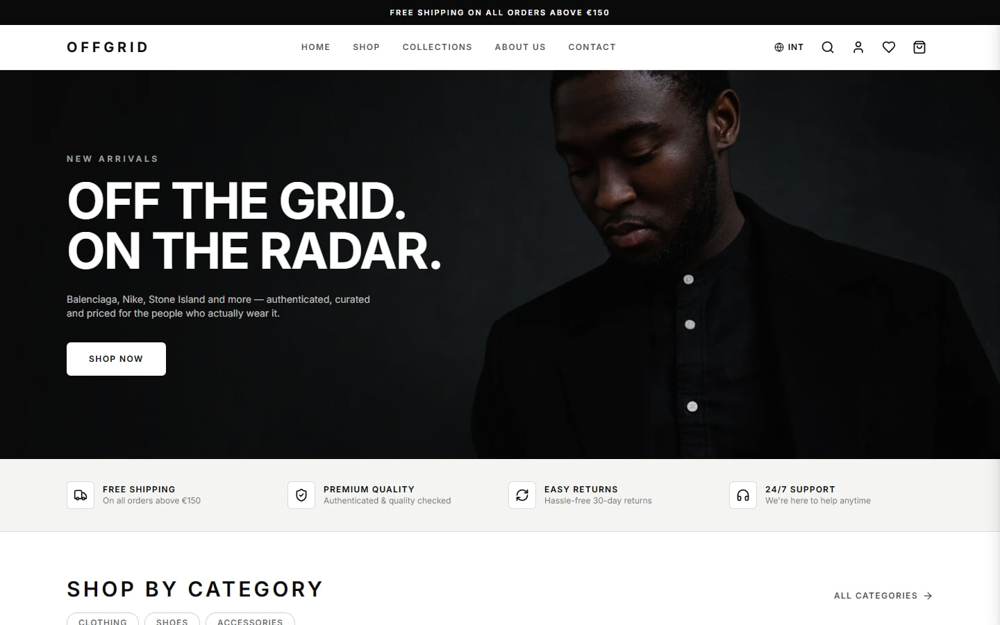
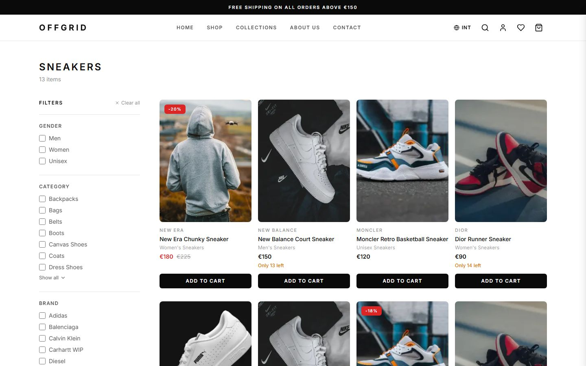
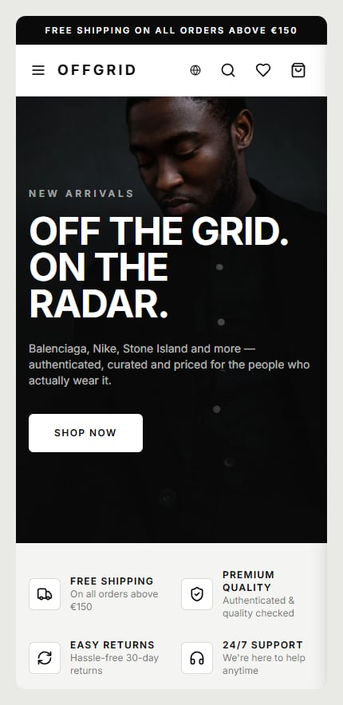

<div align="center">

# OFFGRID

**A multi-brand fashion storefront with a filterable catalog, per-user carts, Stripe checkout and an admin panel.**

[**Live demo →**](https://offgrid-wheat.vercel.app)


[](https://github.com/terartem15-svg/offgrid/actions/workflows/ci.yml)

</div>

---

## Contents

- [About](#about)
- [Screenshots](#screenshots)
- [Features](#features)
- [Tech stack](#tech-stack)
- [Engineering highlights](#engineering-highlights)
- [Getting started](#getting-started)
- [Environment variables](#environment-variables)
- [Scripts](#scripts)
- [Project structure](#project-structure)
- [Testing and quality](#testing-and-quality)
- [Deployment](#deployment)
- [Notes](#notes)
- [License](#license)

## About

OFFGRID is a full-stack e-commerce application, built end to end as a portfolio project: a storefront for a
multi-brand fashion shop (sneakers, clothing, accessories) with everything a real shop needs behind it —
catalog and search, accounts, a payment flow that survives retries and race conditions, and an admin area for
managing products and orders.

It is a **demo**: the products are fictional and payments run in Stripe **test mode**, so nothing real is ever
charged.

**Try it:** [live demo](https://offgrid-wheat.vercel.app) · pay with the Stripe test card `4242 4242 4242 4242`
(any future expiry date, any CVC).

## Screenshots



| Catalog with filters | Mobile |
| --- | --- |
|  |  |

## Features

### Storefront

- **Home page** with a hero, auto-scrolling category and "trending" rails (they pause on hover and while you
  drag) and a collections marquee.
- **SHOP mega menu** — gender → section → categories / brands — with photo cards that load lazily on first hover,
  and a matching slide-in drawer on small screens.
- **Catalog** filterable by gender, category, brand, size, color and price range, plus *New*, *Sale* and
  *Featured* views. Filters live in the URL, so any result page is shareable. Numbered pagination (24 products
  per page).
- **Live search** with a debounced request to the API.
- **Product page** with a color-aware gallery (photos follow the selected colorway), per-color stock (sold-out
  sizes are disabled, sold-out colors are dimmed), a copyable SKU, sale pricing, an animated info modal for
  shipping / returns / payment, and related products streamed in behind a Suspense boundary.
- **Product cards** with a hover photo carousel, a discount badge, a wishlist heart, an occasional
  "only N left" hint and a quick add that asks for the size (products with several colorways open their page
  instead), so a card never puts an unspecified size in the cart.
- **Cart drawer** with a free-shipping progress bar (free above €150, flat €9.99 below).
- **Wishlist drawer.** Cart and wishlist are persisted in the browser (Zustand) and are kept **separately per
  signed-in user**, so switching accounts never leaks one person's items into another's. What a guest collected
  is carried into the account on sign-in, so checkout's "sign in first" step doesn't empty the cart.
- **Three languages** — English (the default), Romanian and Russian — with a region / language switcher.
- **About** and **Contact** pages.

### Accounts

- Registration and login with the Auth.js credentials provider, bcrypt-hashed passwords and JWT sessions.
- `CUSTOMER` and `ADMIN` roles; an account page with order history.

### Checkout and payments

- **Stripe hosted Checkout** (card). The order is created as `PENDING` with its stock reserved, and the Stripe
  session expires after 30 minutes.
- **Webhooks** (`checkout.session.completed`, `expired`, `async_payment_succeeded`, `async_payment_failed`,
  `charge.refunded`) move the order through paid / cancelled / refunded.
- Backing out of Stripe keeps the cart; retrying expires the previous session, so a shopper never holds two
  stock reservations at once.
- The confirmation page asks Stripe for the session state itself, so it is correct even if the webhook has not
  arrived yet.

### Guest quick order

- "Buy now" without an account or a payment: leave a name and phone (plus an address for delivery), pick
  delivery or pickup, and a manager calls back to confirm — a common flow in CIS stores.
- The endpoint is rate limited per IP, and a daily cron job cancels quick orders left unconfirmed for 48 hours
  and returns their stock.

### Admin panel (`/admin`)

- **Dashboard** with counters for products, orders, pending orders, paid revenue and low-stock variants.
- **Products:** list, create and edit with gender, an optional old (sale) price, variants (size / color / stock /
  price override) and image URLs.
- **Orders:** card and guest orders, status management, and real **Stripe refunds** with automatic restocking.

## Tech stack

| Area | Technology |
| --- | --- |
| Framework | [Next.js 15](https://nextjs.org/) (App Router, Server Components, Server Actions, Route Handlers), React 19 |
| Language | TypeScript 5 in `strict` mode |
| Styling | Tailwind CSS 3, `tailwindcss-animate`, `class-variance-authority`, `lucide-react` icons |
| Database | PostgreSQL 16, [Prisma 6](https://www.prisma.io/) (migrations + seed script) |
| Auth | [Auth.js](https://authjs.dev/) (NextAuth v5) credentials provider, `bcryptjs` |
| Payments | [Stripe](https://stripe.com/) — hosted Checkout, webhooks, refunds |
| State | Zustand with `persist` (cart, wishlist, region) |
| Validation | Zod on every write endpoint and server action |
| Tooling | ESLint, `tsx`, Docker Compose (local database), Playwright (payment E2E harness) |
| Hosting | Vercel (including Vercel Cron); Postgres via Supabase or any provider |

## Engineering highlights

- **Stock is never oversold.** Reservation is a conditional `updateMany` (`stock >= quantity`), so two concurrent
  checkouts can't both take the last unit.
- **Order status changes are idempotent.** Every transition is a compare-and-swap on the current status, and the
  stock release / re-reserve happens in the same transaction. A webhook retry, the confirmation page and an admin
  click racing each other perform each transition exactly once.
- **Resilient payment confirmation.** Stripe webhooks are verified against the raw request body; the confirmation
  page reconciles with Stripe directly, so a delayed or missing webhook (local development) never shows a wrong
  state.
- **Abuse-aware public endpoint.** The unauthenticated quick-order endpoint reserves real stock, so it has a
  per-IP rate limit and a cron-based cleanup for abandoned orders.
- **Defense in depth for the admin area.** The layout redirects non-admins, and every server action also calls
  `requireAdmin()` itself, because server actions are reachable over their own endpoint regardless of which page
  rendered them.
- **Rendering tuned for perceived speed.** Related products stream behind Suspense, `React.cache()` de-duplicates
  the product query shared by `generateMetadata` and the page, and the mega menu fetches its photos lazily with
  CDN cache headers.
- **Hydration-safe "randomness".** The "only N left" hint is derived from a hash of the product slug instead of
  `Math.random()`, so server and client render the same value and it stays stable between visits.
- **Typed end to end.** Prisma-generated types, Zod schemas at the boundaries and strict TypeScript. Database
  changes ship as ordered Prisma migrations.
- **A readable history.** The repository is organized as small, focused Conventional Commits, one feature at a
  time.

## Getting started

### Prerequisites

- **Node.js** 18.18 or newer (20 LTS recommended) and npm
- **Docker** for the local PostgreSQL database — or any PostgreSQL instance you already have
- A **[Stripe](https://dashboard.stripe.com/test/apikeys) account in test mode** and the
  **[Stripe CLI](https://stripe.com/docs/stripe-cli)** — only needed to try the payment flow

### 1. Clone and install

```bash
git clone https://github.com/terartem15-svg/offgrid.git
cd offgrid
npm install          # also runs `prisma generate`
```

### 2. Configure the environment

```bash
cp .env.example .env
```

Open `.env` and fill in the values. The database defaults already match `docker-compose.yml`. Generate the auth
secret with `npx auth secret` (or `openssl rand -base64 32`) and paste it as `AUTH_SECRET`. The Stripe and cron
variables are only needed for checkout and the cleanup job — see [Environment variables](#environment-variables).

### 3. Start the database, migrate and seed

```bash
npm run db:up                # PostgreSQL 16 in Docker
npx prisma migrate deploy    # apply the migrations
npm run db:seed              # demo brands, categories, products and two users
```

> [!WARNING]
> The seed script **deletes** existing orders, products, categories, brands, accounts and sessions before it
> inserts the demo data. Never run it against a database you care about.

The seed creates two accounts (password `password123` for both) that exist only in databases you seed yourself:

| Role | Email |
| --- | --- |
| Admin | `admin@offgrid.dev` |
| Customer | `customer@offgrid.dev` |

### 4. Run the app

```bash
npm run dev
```

Open <http://localhost:3000>.

### 5. Try the payment flow (optional)

1. Put your Stripe **test** keys into `.env` (`STRIPE_SECRET_KEY`, `NEXT_PUBLIC_STRIPE_PUBLISHABLE_KEY`).
2. In a second terminal, sign in once with `stripe login`, then forward webhooks to the app:

   ```bash
   npm run stripe:listen
   ```

   The CLI prints a signing secret (`whsec_…`) — paste it into `.env` as `STRIPE_WEBHOOK_SECRET` and restart
   `npm run dev`.
3. Add a product to the cart, sign in and check out with the test card `4242 4242 4242 4242` (any future expiry
   date, any CVC). Set an order to *Refunded* in `/admin/orders` to see a real Stripe refund and the stock come
   back.

## Environment variables

| Variable | Required for | Description |
| --- | --- | --- |
| `DATABASE_URL` | Everything | PostgreSQL connection string used by the app (a pooled URL in production). |
| `DIRECT_URL` | Everything | Direct, non-pooled connection used by migrations. For a local database it is the same as `DATABASE_URL`. |
| `AUTH_SECRET` | Sign-in | Secret used to sign sessions. Generate with `npx auth secret`. |
| `NEXTAUTH_URL` | Sign-in | Public URL of the site, e.g. `http://localhost:3000`. |
| `STRIPE_SECRET_KEY` | Checkout | Stripe secret key (`sk_test_…`). |
| `NEXT_PUBLIC_STRIPE_PUBLISHABLE_KEY` | Checkout | Stripe publishable key (`pk_test_…`). |
| `STRIPE_WEBHOOK_SECRET` | Checkout | Signing secret of the webhook endpoint (`whsec_…`). |
| `CRON_SECRET` | Cleanup job | Any random string; protects `/api/cron/expire-quick-orders`. |

`.env.example` documents each variable, including the Supabase connection strings.

## Scripts

| Command | What it does |
| --- | --- |
| `npm run dev` | Start the development server on port 3000. |
| `npm run build` | Generate the Prisma client and build for production. |
| `npm start` | Serve the production build. |
| `npm run lint` | Run ESLint through `next lint`. |
| `npm test` | Run the unit tests (Node's built-in test runner). |
| `npm run db:up` / `db:down` | Start / stop the local PostgreSQL container. |
| `npm run db:migrate` | Create and apply a development migration (`prisma migrate dev`). |
| `npm run db:seed` | Wipe and reseed the demo data. |
| `npm run db:reset` | Drop the database, re-apply all migrations and re-seed — without a confirmation prompt. |
| `npm run db:studio` | Open Prisma Studio. |
| `npm run stripe:listen` | Forward Stripe webhooks to the local server. |

## Project structure

```text
offgrid/
├── prisma/
│   ├── schema.prisma          # data model
│   ├── migrations/            # ordered SQL migrations
│   └── seed.ts                # demo catalog and users
├── src/
│   ├── app/
│   │   ├── (auth)/            # login, register
│   │   ├── (shop)/            # catalog, product, checkout, account, order confirmation
│   │   ├── admin/             # dashboard, products, orders
│   │   ├── about/  contact/   # static pages
│   │   └── api/               # checkout, webhooks, quick-order, cron, search, menu-media, brands, register, auth
│   ├── components/            # account, admin, cart, catalog, home, layout, product, shared, ui, wishlist
│   ├── lib/
│   │   ├── actions/           # admin server actions (products, orders)
│   │   ├── order-state.ts     # order status transitions + stock bookkeeping
│   │   ├── products.ts        # catalog queries
│   │   ├── i18n.ts            # EN / RO / RU dictionaries
│   │   └── …                  # stripe, prisma, admin guard, formatting helpers
│   ├── store/                 # Zustand stores: cart, wishlist, region
│   └── auth.ts                # Auth.js configuration
├── .e2e/                      # local Stripe payment test harness
├── .github/workflows/ci.yml   # type check, lint and unit tests
├── docs/screenshots/          # images used in this README
├── docker-compose.yml         # local PostgreSQL
└── vercel.json                # build command (runs migrations) and cron schedule
```

## Testing and quality

```bash
npx tsc --noEmit      # type-check the whole project
npm run lint          # ESLint
npm test              # unit tests
```

**Unit tests** (`src/**/*.test.ts`) cover the pure helpers that guard against bad input: the same-origin check
for `callbackUrl` after sign-in, parsing of untrusted catalog query parameters, and price formatting. They run on
Node's built-in test runner through `tsx`, without a database. GitHub Actions runs the type check, lint and unit
tests on every push and pull request ([`.github/workflows/ci.yml`](.github/workflows/ci.yml)).

**Payment end-to-end test.** `.e2e/` contains a throwaway harness that drives a real browser through Stripe's
hosted test-mode Checkout against a temporary embedded PostgreSQL, with webhooks forwarded by the Stripe CLI. It
covers paying with a test card, backing out and retrying, an admin refund, and a refund made from the Stripe
Dashboard. The test refuses to run unless `DATABASE_URL` points at the temporary database. Setup steps are at the
top of [`.e2e/e2e-payment.test.ts`](.e2e/e2e-payment.test.ts).

## Deployment

The app is built for [Vercel](https://vercel.com/):

1. **Database.** Create a PostgreSQL database (for example on Supabase). Use the *pooled* connection string as
   `DATABASE_URL` (with `?pgbouncer=true`) and the *direct* one as `DIRECT_URL`.
2. **Migrations.** The Vercel build (`buildCommand` in `vercel.json`) runs `prisma migrate deploy` before
   `next build`, so every deploy applies pending migrations through `DIRECT_URL` first. A failed migration fails
   the build, and the previous deployment keeps serving. Locally, `npm run build` only generates the client.
3. **Environment.** Set every variable from the table above in the Vercel project. Keep Stripe in **test mode**
   for a public demo.
4. **Stripe webhook.** Add `https://<your-domain>/api/webhooks/stripe` as an endpoint in the Stripe Dashboard with
   the events `checkout.session.completed`, `checkout.session.expired`, `checkout.session.async_payment_succeeded`,
   `checkout.session.async_payment_failed` and `charge.refunded`, and use its signing secret as
   `STRIPE_WEBHOOK_SECRET`.
5. **Cron.** `vercel.json` schedules `/api/cron/expire-quick-orders` daily at 03:00 UTC. Vercel sends
   `CRON_SECRET` as a bearer token automatically.

## Notes

- Product photos are hot-linked from [Unsplash](https://unsplash.com/) and [Pexels](https://www.pexels.com/),
  and the copy is placeholder text. Every product has its own pair of photos, picked by eye to show that kind of
  item (a penny loafer for a penny loafer), but not always the exact model or brand in its name.
- The home page hero photo is by [SHVETS production on Pexels](https://www.pexels.com/photo/serious-black-man-in-black-suit-standing-in-studio-7533323/)
  ([Pexels license](https://www.pexels.com/license/)), stored in `public/hero.webp`.
- The region switcher changes the **language** only; prices are always shown and charged in EUR.
- This is a portfolio project, not a production store.

## License

The code is released under the [MIT License](LICENSE). Brand names in the demo catalog belong to their owners.
